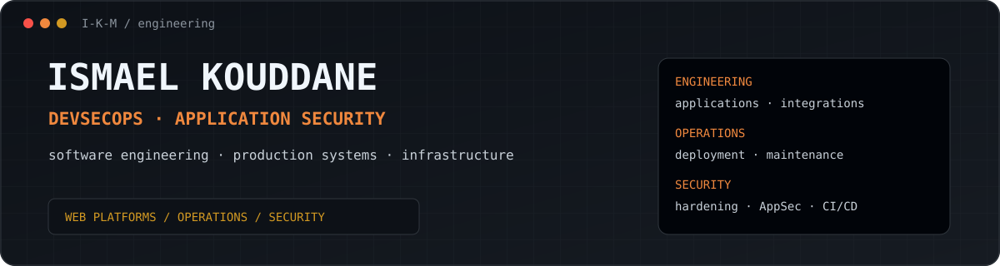

<p align="center">
  
</p>

---

## About

I'm a freelance DevSecOps engineer working across software engineering, infrastructure and cybersecurity. I design and develop technical solutions, manage production environments, automate workflows and improve the security and reliability of applications and systems.

My work combines hands-on engineering with **DevSecOps, application security and infrastructure hardening**, with a focus on Linux, CI/CD, secure deployments and AWS.

## Areas of work

```text
DevSecOps          CI/CD · Git · automations
AppSec             Web security · APIs · RAGs & AI solutions
Infrastructure     Linux · hosting · Docker · monitoring
Cloud Security     AWS · IAM · Terraform
Engineering        Web applications · integrations · maintenance
```

## Toolbox

### Infrastructure & security

<p>
  
</p>

`Linux` · `Docker` · `AWS` · `Terraform` · `GitHub` · `nginx` · `Wireshark`

### Development & automation

<p>
  
</p>

`Python` · `php` · `Node` · `Go` · `Bash` · `TS`
